<p align="center"><a href="https://drophlex.github.io/dark-funk-durcal-synt-fm1/">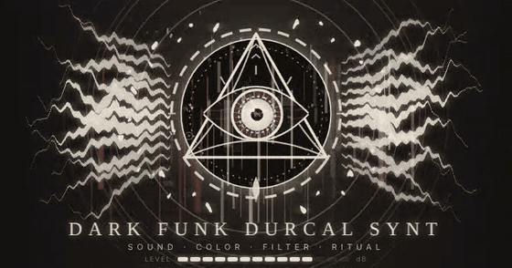</a></p>

<h1 align="center">DARK FUNK DURCAL SYNT</h1>
<p align="center"><b>Música oscura hecha a tu estado de ánimo · Dark music made to your mood</b><br>
Acid · breaks · jungle · drum'n'bass · rave · funk deformado · IDM<br>
<i>Gratis · sin instalar · siempre en tono · para tocar en vivo</i></p>

<p align="center">
<a href="https://drophlex.github.io/dark-funk-durcal-synt-fm1/web/DarkFunkDurcalSynt.html"></a>
<a href="https://drophlex.github.io/dark-funk-durcal-synt-fm1/install/DarkFunkDurcal-Installer.html"></a>
<a href="#-plugin-para-ableton"></a>
</p>
<p align="center">
<a href="https://drophlex.github.io/dark-funk-durcal-synt-fm1/"><b>🌐 Página oficial</b></a> ·
<a href="manual/DarkFunkDurcal-Manual-ES.pdf"><b>📘 Manual (ES)</b></a> ·
<a href="manual/DarkFunkDurcal-Manual-EN-ES.pdf"><b>📗 Manual (EN + ES)</b></a> ·
<a href="https://github.com/drophlex/dark-funk-durcal-synt-fm1/releases/latest"><b>⬇ Última versión</b></a> ·
<a href="#english"><b>English</b></a>
</p>

---

## ✨ Lo que todos buscan

| | |
|---|---|
| ◉ **Una canción con un botón** | Elige dos de 15 estilos, mézclalos y pulsa **SUMMON**: batería, acid, bajo y melodía al mismo tiempo. |
| ♪ **Siempre en tono** | No necesitas saber música: cada nota encaja con el estado de ánimo (oscuro, acid, funky, melancólico, soñador, alien, rave, hipnótico, soul). |
| ⚡ **Modo en vivo** | 8 pads: mutes, fill, stutter, build y drop. Escenas que cambian al final del compás, sin cortes. |
| ✦ **3 ideas para tu melodía** | **NEXT PHRASE**: una respuesta, una variación y una tensión de lo que tocaste. |
| ⇢ **Tu MIDI a tu DAW** | Exporta `.mid`, arrastra el MIDI del plugin a Ableton o carga cualquier `.mid` al FM-1. |
| ◬ **Un ojo que siente la música** | Luz cálida y fría, chorreados de pixel y glitch que crecen con el volumen. |

## ⚡ Guía rápida

### 🌐 En el navegador (compu o celular)

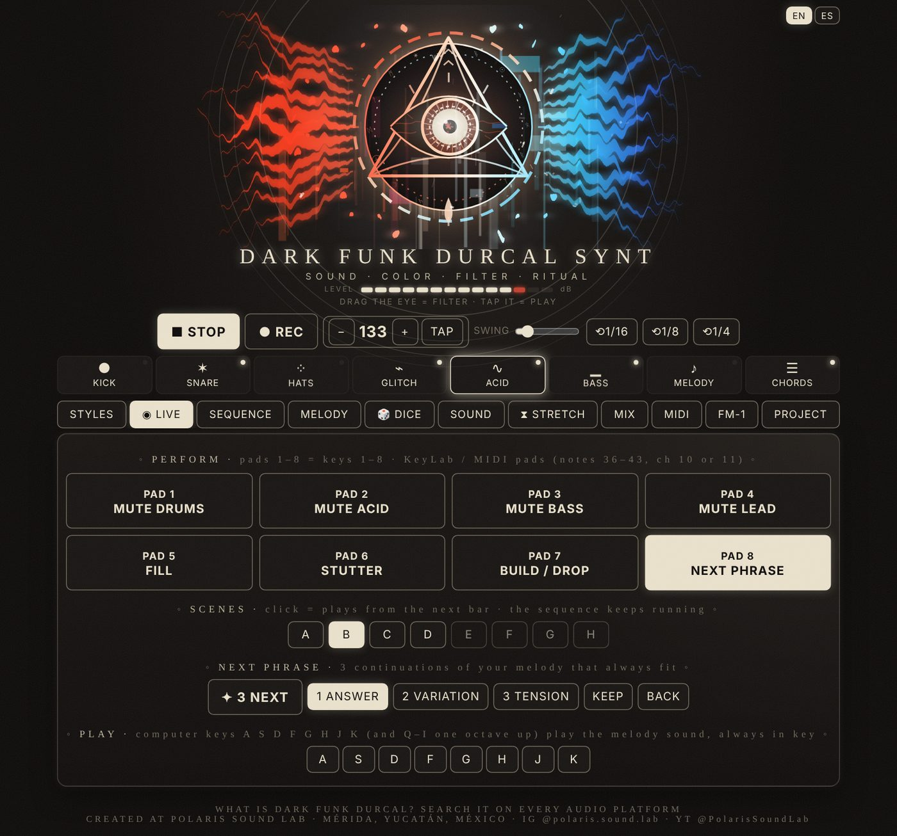

1. Abre **[▶ TOCAR AHORA](https://drophlex.github.io/dark-funk-durcal-synt-fm1/web/DarkFunkDurcalSynt.html)** y toca **◉ AWAKEN** (con audífonos).
2. **STYLES** → dos estilos (prueba *Warped Funk* × *Broken Funk*) → **SUMMON FULL TRACK**.
3. **◉ LIVE** → pads `1`–`4` silencian · `5` fill · `6` stutter · sostén `7` y suelta = **drop** · `8` next phrase.
4. Teclas `A`…`K` tocan la melodía en tono. **PROJECT** guarda, exporta `.mid` o graba audio.

<br clear="right">

### 🎛 En el M-VAVE FM-1

1. Cable USB-C **de datos** directo a la compu. Cierra apps MIDI.
2. Abre el **[instalador](https://drophlex.github.io/dark-funk-durcal-synt-fm1/install/DarkFunkDurcal-Installer.html)** en Chrome o Edge → **Install** → permite MIDI. *(Siempre puedes regresar al firmware oficial.)*
3. `HOME` ×3 = **RITUAL** → K1/K2 dos estilos → `OCT+` **SUMMON**.
4. `HOME` ×7 = **LIVE** (mutes, repeat, build, throw, `OCT+` DROP) · `HOME` ×8 = **NEXT** (3 ideas, `OCT+` KEEP).

<p align="center">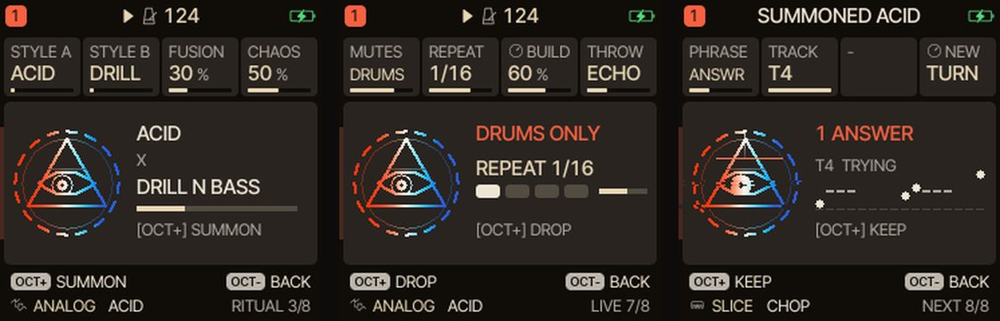</p>

### 🎹 Plugin para Ableton

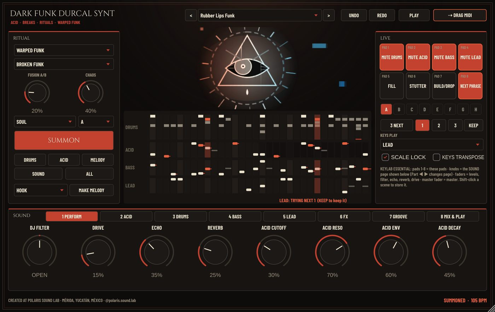

1. Pídelo por DM a **[@polaris.sound.lab](https://www.instagram.com/polaris.sound.lab/)** → `DarkFunkDurcalSynt-v2-macOS.zip` (Mac Apple Silicon o Intel).
2. Descomprime → clic derecho en **Install.command** → **Abrir**.
3. Ableton › Plug-Ins › Polaris Sound Lab › **Dark Funk Durcal Synt** en una pista MIDI. Arrastra **DRAG MIDI** a un clip.
4. **KeyLab Essential:** Settings › Link, Tempo & MIDI › Control Surface **DFD_KeyLab_Essential**. Pantalla, perillas, faders, pads y teclas listos.

<br clear="right">

## 📸 Fotos de referencia

<p align="center">
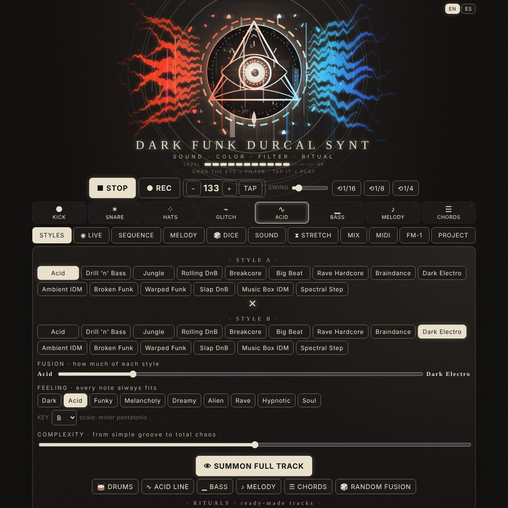
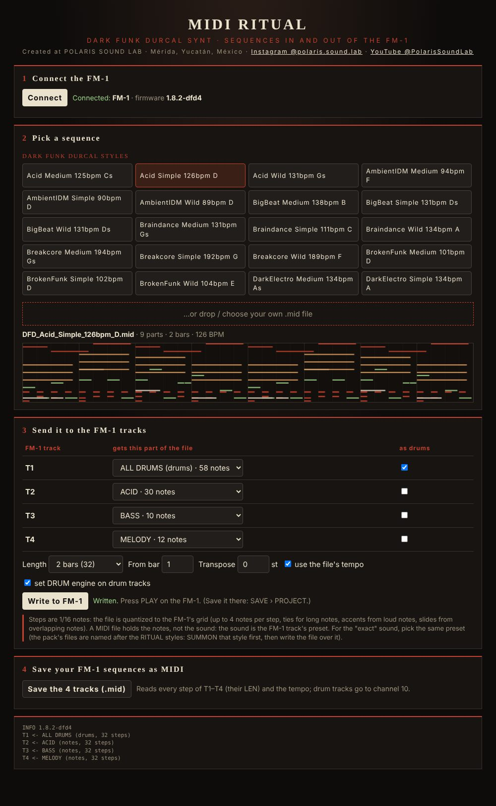
</p>
<p align="center">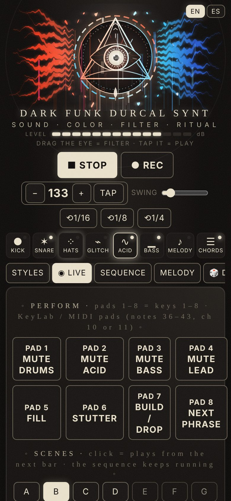<br><i>En el celular: pads grandes para tocar con los dedos.</i></p>

## ⬇ Descargas

| | |
|---|---|
| ▶ **Groovebox web** | [Abrir en el navegador](https://drophlex.github.io/dark-funk-durcal-synt-fm1/web/DarkFunkDurcalSynt.html) · [archivo .html](web/DarkFunkDurcalSynt.html) (funciona sin internet) |
| ⬇ **Firmware FM-1 1.8.2-dfd6** | [Abrir el instalador](https://drophlex.github.io/dark-funk-durcal-synt-fm1/install/DarkFunkDurcal-Installer.html) · [`.fwsc`](https://github.com/drophlex/dark-funk-durcal-synt-fm1/releases/latest/download/DarkFunkDurcal-1.8.2-dfd6.fwsc) |
| ⇢ **MIDI Ritual** | [Abrir](https://drophlex.github.io/dark-funk-durcal-synt-fm1/web/DarkFunkDurcal-MIDI-Ritual.html): carga `.mid` al FM-1 y guarda tus pistas |
| ♫ **MIDI Pack** | [50 secuencias (.zip)](midi/DarkFunkDurcal-MIDI-Pack.zip): estilos, clásicos y breaks |
| ◈ **Banco FM** | [DX7 `.syx`](sounds/DarkFunkDurcal_DX7.syx): 32 voces para Dexed o cualquier DX7 |
| 📘 **Manuales** | [Español](manual/DarkFunkDurcal-Manual-ES.pdf) · [English + Español](manual/DarkFunkDurcal-Manual-EN-ES.pdf): cada paso con imágenes |
| 🎹 **Plugin (Mac)** | Por DM a [@polaris.sound.lab](https://www.instagram.com/polaris.sound.lab/) |

## ❓ Preguntas frecuentes

<details><summary><b>¿Es gratis?</b></summary>

Sí: la web, el firmware, el pack MIDI y los manuales. El plugin se pide por DM a @polaris.sound.lab.
</details>
<details><summary><b>¿Funciona en mi celular o iPhone?</b></summary>

La web suena en cualquier navegador moderno. Lo que usa MIDI (FM-1, instalador, MIDI Ritual) va en Chrome o Edge en una compu; Safari en iPhone no tiene Web MIDI.
</details>
<details><summary><b>¿Puedo regresar al firmware oficial del FM-1?</b></summary>

Sí. El instalador primero guarda un respaldo de tu música y tiene la opción de volver al firmware oficial de M-VAVE.
</details>
<details><summary><b>¿Puedo publicar lo que haga?</b></summary>

Sí. Sonidos y secuencias son originales (inspirados en el IDM y el funk deformado de los 90, sin nombres de artistas ni melodías con derechos). Lo que hagas es tuyo.
</details>
<details><summary><b>¿El plugin funciona en Windows?</b></summary>

Por ahora solo Mac (AU y VST3). En Windows usa la versión web en Chrome o Edge.
</details>

---

## English

**Dark music made to your mood.** Make a track in 10 seconds and play it live all night: acid, chopped breaks, jungle,
drum'n'bass, rave, warped funk and IDM — always in key, no music theory needed.

- ▶ **Play now in the browser:** https://drophlex.github.io/dark-funk-durcal-synt-fm1/web/DarkFunkDurcalSynt.html (computer or phone, nothing to install)
- ⬇ **M-VAVE FM-1:** open the [installer](https://drophlex.github.io/dark-funk-durcal-synt-fm1/install/DarkFunkDurcal-Installer.html) in Chrome or Edge with the FM-1 on USB → **Install**
- 🎹 **Ableton plugin (Mac, AU / VST3, KeyLab Essential script):** DM [@polaris.sound.lab](https://www.instagram.com/polaris.sound.lab/)
- 📗 **Manual (English + Spanish):** [PDF](manual/DarkFunkDurcal-Manual-EN-ES.pdf) · 🌐 **Website:** https://drophlex.github.io/dark-funk-durcal-synt-fm1/

**Quick guide** — Web: **◉ AWAKEN** → **STYLES** → two styles → **SUMMON** → **◉ LIVE** pads 1–8 (mute, fill, stutter,
build/drop, next phrase). FM-1: `HOME` ×3 RITUAL → `OCT+` SUMMON · `HOME` ×7 LIVE → `OCT+` DROP · `HOME` ×8 NEXT → `OCT+` KEEP.
Plugin: Install.command → Ableton › Plug-Ins › Polaris Sound Lab → Control Surface **DFD_KeyLab_Essential**.

---

<p align="center"><b>What is Dark Funk Durcal?</b> Search it on <a href="https://open.spotify.com/search/Dark%20Funk%20Durcal">Spotify</a>, <a href="https://www.youtube.com/results?search_query=Dark+Funk+Durcal">YouTube</a> and every audio platform.<br>
Created at <b>POLARIS SOUND LAB</b> · Mérida, Yucatán, México<br>
<a href="https://www.instagram.com/polaris.sound.lab/">Instagram @polaris.sound.lab</a> · <a href="https://www.youtube.com/@PolarisSoundLab">YouTube @PolarisSoundLab</a></p>

<details><summary><b>📂 Detalles técnicos, archivos, compilar el firmware y licencias · Technical details, files, building and licences</b></summary>

## What it is

Dark Funk Durcal Synt turns the FM-1 into a dark, easy groovebox for acid lines, chopped breaks, jungle, drum'n'bass,
braindance and rave — with no music theory needed: every generated note is always in key.

It is a fork of [Felucca 1.8.2](https://github.com/hugelton/Felucca) (GPL-3.0, Hügelton Instruments). **Every sound
and feature of Felucca stays**; Dark Funk Durcal adds:

| | |
|---|---|
| **RITUAL** | Pick two of 11 styles (ACID, DRILL N BASS, JUNGLE, ROLLING DNB, BREAKCORE, BIG BEAT, RAVE HARDCORE, BRAINDANCE, DARK ELECTRO, AMBIENT IDM, BROKEN FUNK), blend them with FUSION, add CHAOS and press **SUMMON**: drums or a chopped break, acid, bass and melody in all 4 tracks at once. |
| **MELODY** | Feel (scale), key, shape (WAVE, RISE, FALL, Q&A, ARP, HOOK, FEW, BUSY) and density → **MAKE**. Always in key. |
| **DICE** | Each knob rolls a die for one part (drums, acid, melody, sound) — or roll them **ALL**. Hold SAVE to undo. |
| **STRETCH** | Easy granular time-stretch locked to the tempo: FREEZE, 1/2, 1, 2, 4 bars; pitch ±12 without changing time. |
| **TAPE ECHO** *(new in dfd4)* | A three-head tape echo on the delay: HEADS (H1, H2, H3, H1+2, H2+3, H1+3, ALL), WOW (wow, flutter and tape saturation). Repeats at TIME ×1 ×2 ×3, darkening and never running away. |
| **The living eye** *(new in dfd4)* | The animated eye on HOME and the Dark Funk Durcal pages **reacts to the music**: calm and half-closed in ambient, furious (frown, veins, red iris, trembling) when the tempo, density, volume, distortion and resonance rise. Works with MENU › LARGE too. |
| **Sounds** | 10 new acid / bass / pad presets on the ANALOG engine (DFD ACID, SQUELCH, BLACK ACID, RUBBER ACID, SERPENT, ACID LASER, ACID 2, REESE, DETUNE PAD, BRAIN LEAD) and a 32-voice FM bank (FM6 SLOT B1–B32). |
| **Boot ritual** | An animated eye splash: *What is Dark Funk Durcal? Search it on Spotify, YouTube and every audio platform* · *Created at Polaris Sound Lab · Mérida, Yucatán, México*. |
| **MIDI Ritual** *(new)* | A web page that writes MIDI files into the FM-1 tracks and saves your FM-1 tracks as `.mid`, with a pack of 50 sequences built in. |

<p align="center">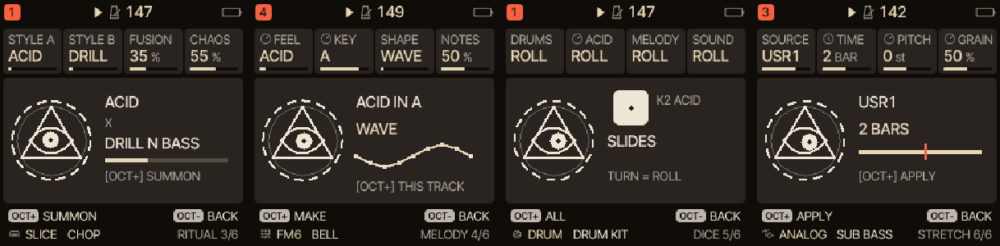</p>
<p align="center">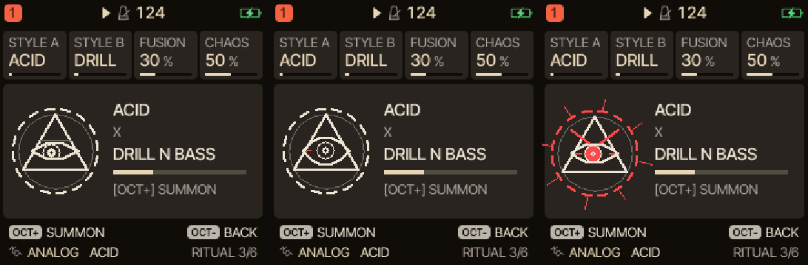<br><i>The living eye: calm · awake · furious</i></p>

## Files in this repository

| Path | What it is |
|---|---|
| [`install/DarkFunkDurcal-Installer.html`](install/DarkFunkDurcal-Installer.html) | **The installer.** Open it in Chrome or Edge with the FM-1 on USB and press *Install*. The firmware is inside it. It can also take you back to the official M-VAVE firmware. |
| [`install/DarkFunkDurcal-1.8.2-dfd6.fwsc`](install/DarkFunkDurcal-1.8.2-dfd6.fwsc) | The firmware package itself (for Felucca's tools / advanced users). Identity FM-1_946. |
| [`manual/DarkFunkDurcal-Manual-EN-ES.pdf`](manual/DarkFunkDurcal-Manual-EN-ES.pdf) | The full illustrated manual, English then Spanish (58 pages: web, FM-1 and plugin, with every install step). |
| [`manual/DarkFunkDurcal-Manual-ES.pdf`](manual/DarkFunkDurcal-Manual-ES.pdf) | The manual in Spanish only (29 pages). |
| [`web/DarkFunkDurcalSynt.html`](web/DarkFunkDurcalSynt.html) | The web groovebox: 8 channels, styles A × B, dice, melody maker, acid tool, time-stretch, MIDI out / clock, `.mid` export, FM-1 screen preview. Works offline in any modern browser. |
| [`web/DarkFunkDurcal-MIDI-Ritual.html`](web/DarkFunkDurcal-MIDI-Ritual.html) | MIDI Ritual: load a `.mid` (or one of the 50 built-in) into the FM-1's tracks; save the FM-1's 4 tracks as `.mid`. Chrome / Edge. |
| [`midi/pack/`](midi/pack) | 33 sequences, 3 per style (Simple / Medium / Wild): drums on ch 10, acid, bass, melody, chords. |
| [`midi/classics/`](midi/classics) | 10 public-domain classics re-arranged as loops (Bach, Beethoven, Mozart, Grieg, Chopin, Pachelbel, Dies Irae, Greensleeves) and 7 classic break rhythms programmed from scratch (Amen, Funky Drummer, Think, Apache, Impeach styles, two-step). |
| [`midi/DarkFunkDurcal-MIDI-Pack.zip`](midi/DarkFunkDurcal-MIDI-Pack.zip) | All of the above in one zip. |
| [`sounds/DarkFunkDurcal_DX7.syx`](sounds/DarkFunkDurcal_DX7.syx) | The 32-voice FM bank as a DX7 SysEx bank (for Dexed or any DX7-compatible synth). On the FM-1 it is already built in. |
| [`firmware-src/`](firmware-src) | The complete source code of this firmware (Felucca 1.8.2 + Dark Funk Durcal), as the GPL-3.0 requires. [`DARK-FUNK-DURCAL.patch`](firmware-src/DARK-FUNK-DURCAL.patch) shows every change against Felucca 1.8.2. |
| [`tools/`](tools) | Scripts that generate the classics MIDI files, the DX7 bank and the MIDI Ritual page. |
| [`docs/images/`](docs/images) | Screens rendered from the real firmware drawing code. |

## Install (short version — the manual has every step with pictures)

1. Use a **USB-C data cable**, connected **directly** to the computer (no hub). Battery charged.
2. Quit every app that uses MIDI (DAWs, the M-VAVE app, other browser tabs).
3. On a Mac, check *Audio MIDI Setup › Window › Show MIDI Studio*: the **FM-1** icon must be there.
4. Open `install/DarkFunkDurcal-Installer.html` in **Chrome or Edge**, press **Install**, allow MIDI.
5. Wait for *Starting › Verifying › Switching to update mode › Writing › Restarting › Done*. Don't unplug while *Writing*.
6. The FM-1 restarts with the eye animation. Done.

To go back: in the installer open *Return to official firmware (V15 / V16)* and choose the official `FM-1.fwsc` from M-VAVE.
The installer saves a complete backup of your music first.

<p align="center"></p>

## How to reach each screen

| Press | You get |
|---|---|
| **HOME** (repeatedly) | HOME › MIXER › CLOCK › **RITUAL › MELODY › DICE › STRETCH › LIVE › NEXT** › HOME |
| **FX** (repeatedly) | FX › SLICER › INSERT › INSERT 2 › DLY › **TAPE ECHO** › REVERB › CHORUS |
| **SEQ** | STEP › DETAIL › AUTOMATION |
| **EDIT** | the engine's pages (FILTER for the acid, LANES for drums, PATCH / SLOT for FM6…) |
| **SAVE** | USER › PRESETS › PHRASES › PROJECT › TOOLS — hold SAVE = **undo** |
| **ALGORITHM** knob | choose the track T1–T4 · **PRESETS** knob = sound · **SELECT** = tempo |

On the Dark Funk Durcal pages **OCT+** is the action (SUMMON, MAKE, ALL, APPLY, DROP, KEEP) and **OCT−** goes back.

<p align="center">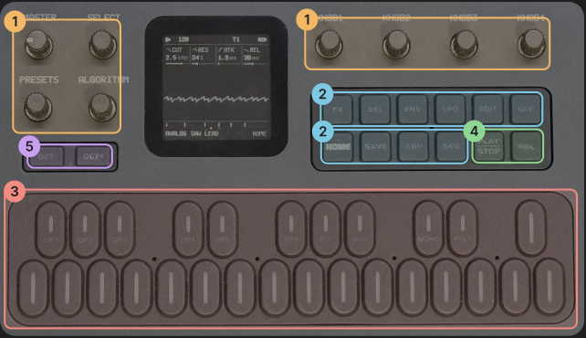</p>

<p align="center">
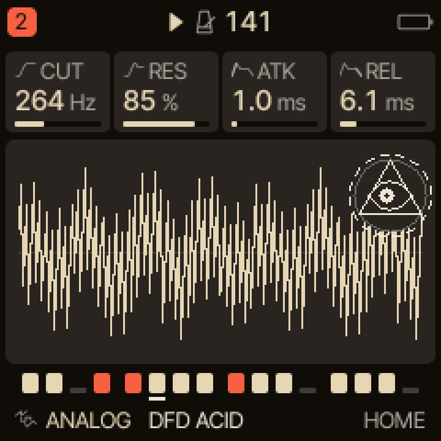 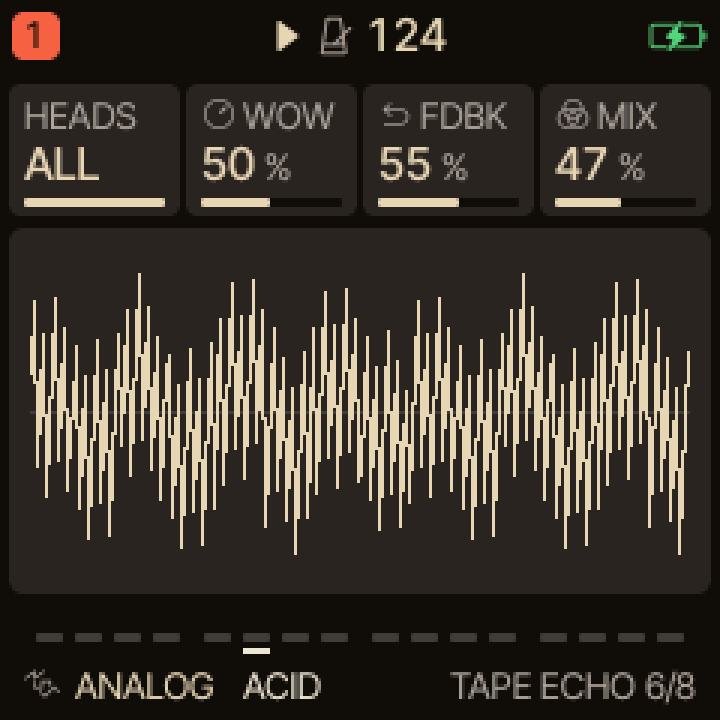  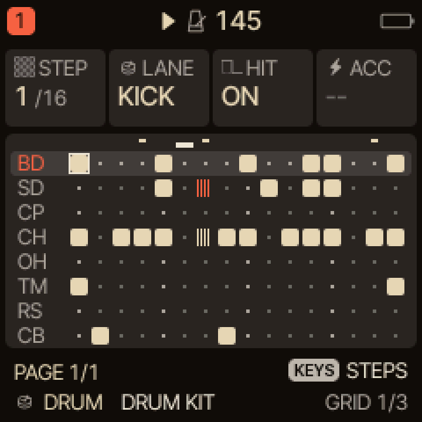
</p>

## MIDI: loading and saving sequences

Open `web/DarkFunkDurcal-MIDI-Ritual.html` in Chrome with the FM-1 connected → **Connect** → pick a sequence (or drop
your own `.mid`) → choose which part goes to T1–T4 → **Write to FM-1**. *Save the 4 tracks* reads your FM-1 tracks and
downloads a `.mid`.

A MIDI file holds **notes, not sound**. For the "exact" sound, SUMMON the style the file is named after (or pick the same
preset) and write the file over it. Melodies of copyrighted songs are not included; the pack brings public-domain
classics and classic break *rhythms* programmed from scratch. Any `.mid` you own you can load yourself.

<p align="center">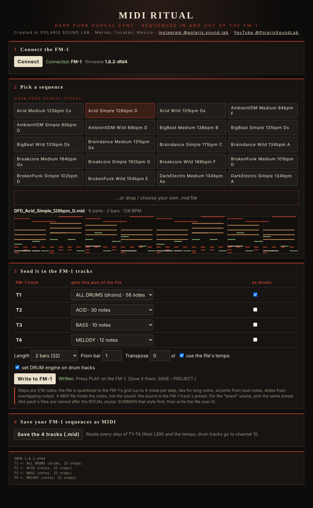</p>

## Play it in the browser

- Web groovebox: https://drophlex.github.io/dark-funk-durcal-synt-fm1/web/DarkFunkDurcalSynt.html
- MIDI Ritual: https://drophlex.github.io/dark-funk-durcal-synt-fm1/web/DarkFunkDurcal-MIDI-Ritual.html

## Identity and The Firmware Hub

The package identity is **FM-1_946**, Dark Funk Durcal's own (it no longer uses Felucca's FM-1_918). The update loader
inside the package is Felucca's, unchanged, so the FM-1 can always install the next firmware or go back to the official
one. Both flash chips are supported (JEDEC `0x856014` and `0xB36014`). [`fmhub.json`](fmhub.json) describes the
firmware for [The Firmware Hub](https://thefirmwarehub.com/); every GitHub release carries the `.fwsc`.

## Build the firmware yourself

See [`firmware-src/BUILDING.md`](firmware-src/BUILDING.md) (JieLi toolchain + three AC79 SDK files). Then:

```sh
cd firmware-src
./build.sh --release 1.8.2-dfd6 --identity FM-1_946   # -> build/felucca-1.8.2-dfd6.fwsc
sh tests/run_tests.sh               # host tests: UI renders, audio goldens, tape echo, fuzzers
```

## Credits and licences

- **Dark Funk Durcal Synt** — created at **Polaris Sound Lab**, Mérida, Yucatán, México.
- Based on **Felucca 1.8.2** by Hügelton Instruments — GPL-3.0, no warranty (see `firmware-src/LICENSE`,
  `firmware-src/LICENSING.md`). Felucca-Engines (MIT), felucca-bsp (MPL-2.0), FM6 engine from Dexed / msfa (Apache-2.0),
  Inter Tight font (SIL OFL 1.1), samples VSCO-2 CE and VCSL (CC0).
- M-VAVE and FM-1 are trademarks of their respective owners. This firmware is not an official M-VAVE product.
  Install it at your own risk, following the manual.

---

### Español (detalles)

### ⬇ Descargas
- 🌐 **WEB:** https://drophlex.github.io/dark-funk-durcal-synt-fm1/ (Chrome o Edge, compu o celular; nada que instalar).
- 🎛 **FM-1:** [Releases](https://github.com/drophlex/dark-funk-durcal-synt-fm1/releases) o [`install/DarkFunkDurcal-Installer.html`](install/DarkFunkDurcal-Installer.html) (firmware 1.8.2-dfd6).
- 🎹 **VST / AU (Mac):** `DarkFunkDurcalSynt-v2-macOS.zip`, pídelo por DM a [@polaris.sound.lab](https://www.instagram.com/polaris.sound.lab/).
- 📘 Manual con cada paso de instalación: [PDF bilingüe](manual/DarkFunkDurcal-Manual-EN-ES.pdf) · [PDF español](manual/DarkFunkDurcal-Manual-ES.pdf).

### ⚡ Guía rápida
**Web:** abre el link en Chrome → **◉ AWAKEN** → **STYLES**: dos estilos y **SUMMON** → pestaña **◉ LIVE**: pads 1–4 silencian,
5 FILL, 6 STUTTER, 7 sostén BUILD y suelta para el DROP, 8 NEXT PHRASE (prueba 1, 2, 3 y **KEEP**). Escenas A–H cambian al
terminar el compás; las teclas A S D F G H J K tocan la melodía siempre en tono.

**FM-1:** instala con el instalador (cable USB-C de datos, Chrome, **Install**, no desconectes en *Writing*) → **HOME** ×3 =
RITUAL → **OCT+ SUMMON** → **HOME** ×7 = **LIVE** (MUTES, REPEAT, BUILD, THROW, **OCT+ DROP**) → **HOME** ×8 = **NEXT**
(ANSWER / VARIATION / TENSION, **OCT+ KEEP**).

**Plugin:** descomprime → clic derecho en **Install.command** › Abrir → en Ableton: Plug-Ins › Polaris Sound Lab ›
**Dark Funk Durcal Synt** → Settings › Link, Tempo & MIDI › Control Surface **DFD_KeyLab_Essential**, entrada y salida
**KeyLab Essential 49 (MIDI)**, Track y Remote en ON. La pantalla del KeyLab muestra lo que mueves; perillas = 8 bancos,
faders = niveles y efectos, pads = los pads LIVE, teclas en escala. Arrastra **DRAG MIDI** a un clip para quedarte con las notas.

**Nuevo en v2:** modo en vivo, NEXT PHRASE, sonidos de funk deformado e IDM (voz que habla, EP aterciopelado, caja de
música, bajo de goma con wah, slap; sin nombres de artistas ni melodías con derechos), el ojo **SMEAR** (cálido, blanco y
frío, con chorreados de pixel) y el plugin para Ableton.

**Dark Funk Durcal Synt** convierte el FM-1 en una groovebox oscura y fácil para líneas acid, breaks troceados, jungle,
drum'n'bass, braindance y rave, sin saber teoría musical: todas las notas generadas siempre están en la escala.

Es una versión de [Felucca 1.8.2](https://github.com/hugelton/Felucca) (GPL-3.0). **Conserva todos los sonidos y
funciones de Felucca** y agrega:

- **RITUAL:** 2 de 11 estilos, FUSION, CHAOS y **SUMMON** llena las 4 pistas.
- **MELODY:** sentimiento, tonalidad, forma y densidad → **MAKE**. Siempre suena bien.
- **DICE:** dados por parte (batería, acid, melodía, sonido) o **ALL**. Mantén SAVE para deshacer.
- **STRETCH:** time-stretch granular amarrado al tempo, con FREEZE y tono ±12.
- **TAPE ECHO (nuevo):** eco de cinta de tres cabezas con WOW (ondulación y saturación). Se llega tocando **FX** 6 veces.
- **El ojo vivo (nuevo):** tranquilo en ambient, furioso (ceño, venas, iris rojo, temblor) cuando la música es intensa.
  Funciona también con MENU › LARGE.
- **Sonidos:** 10 presets acid nuevos y un banco FM de 32 voces (SLOT B1–B32).
- **MIDI Ritual (nuevo):** carga archivos `.mid` (o los 50 del pack) a las pistas del FM-1 y guarda tus pistas como `.mid`.

**Archivos:** el instalador está en `install/`, los manuales en PDF en `manual/` (bilingüe y solo español), la groovebox
web y MIDI Ritual en `web/`, el pack MIDI en `midi/` (estilos, clásicos de dominio público y ritmos de breaks
clásicos), el banco DX7 en `sounds/` y el código fuente completo en `firmware-src/`.

**Instalar:** cable USB-C de datos directo a la Mac, cierra las apps MIDI, abre `install/DarkFunkDurcal-Installer.html`
en Chrome, pulsa **Install**, permite el MIDI y no desconectes mientras dice *Writing*. El manual trae cada paso con
imágenes.

**¿Qué es Dark Funk Durcal?** Búscalo en **Spotify, YouTube y todas las plataformas de audio**: su música está disponible
en cualquier plataforma digital.

**Creado en Polaris Sound Lab · Mérida, Yucatán, México** ·
[Instagram @polaris.sound.lab](https://www.instagram.com/polaris.sound.lab/) ·
[YouTube @PolarisSoundLab](https://www.youtube.com/@PolarisSoundLab)

</details>
